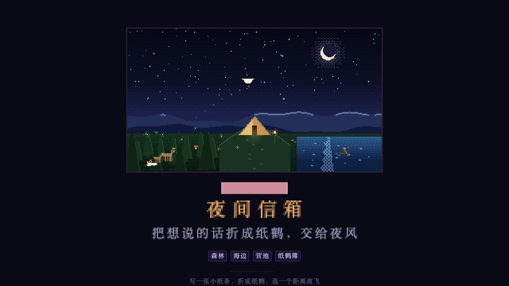

# 夜间信箱 · Night Mailbox

把想说的话折成纸鹤，交给夜风。

一个纯前端的像素风深夜小工具：选一个地方，写一张小纸条，折成纸鹤放飞。没有已读，没有回复，也不用登录。



## 它能做什么

- 三个地点：森林、海边、营地
- 写一张最多 600 字的小纸条，可以顺手记下今天看的片名
- 选择近处、中距离或远方，看纸鹤飞进夜色
- 纸鹤簿：放飞过的纸条会留在本机，最多 300 条，点开可以重读
- 声音开关、日期、纸鹤计数
- 桌面和手机自适应，手机端全宽显示

## 隐私

- 纯静态页面，没有后端、没有数据库、没有账号，也没有统计脚本
- 纸条只写入浏览器本地存储（小红书小工具环境优先使用其 Storage，否则使用 `localStorage`）
- 内容不会上传，也不会跨设备同步
- 清除浏览器缓存、卸载小工具或更换域名后，纸鹤簿会丢失
- 本地存储不加密。共用设备上，后来的人可能看到你写的内容，请不要在公共设备上写敏感信息

## 本地运行

不需要安装依赖，也不需要构建：

```bash
python3 -m http.server 8080
```

然后打开 <http://localhost:8080>。

## 字体说明（重要）

本项目界面使用 **Zpix（最像素）**，版权归 [SolidZORO](https://github.com/SolidZORO/zpix-pixel-font) 所有。Zpix 对个人和教育项目免费，**商业使用需要单独购买授权**。

为遵守字体授权，本仓库**不包含** `zpix.woff2`。没有字体文件时，页面会自动回退到系统字体，功能不受影响；如果想要完整的像素效果，请从官方仓库下载字体，放到项目根目录：

- <https://github.com/SolidZORO/zpix-pixel-font/releases>

```text
night-mailbox/
├── index.html
├── app.js
├── cover.png
├── icon.png
└── zpix.woff2   # 自行下载，不提交到仓库
```

如果你要把这个项目用于商业产品，请先向字体作者购买授权。

## 部署

这是一个静态站点，把 `index.html`、`app.js`、`cover.png`、`icon.png` 放到任意静态托管即可。若已取得字体授权，再一并放入 `zpix.woff2`。

小红书小工具：将上述文件打包成 zip 上传即可。注意，换域名或换环境后，`localStorage` 里的纸鹤簿不会自动迁移。

## 技术细节

- 原生 HTML / CSS / JavaScript，无框架、无构建步骤、无第三方运行时依赖
- Canvas 内部分辨率 320 × 180，用 CSS 做整数倍像素缩放
- 音效由 Web Audio 实时合成，没有音频文件
- 纸鹤簿保存在 `localStorage`，键名：`night-papers`、`night-count`、`night-sound`
- 小红书小工具环境会检测 `xhs.miniTool` 并使用原生 Storage，失败时回退到 `localStorage`

## License

代码以 [MIT](./LICENSE) 许可发布。

`cover.png`、`icon.png` 为项目展示素材，未包含在 MIT 授权范围内；如需复用，请先确认素材权利。Zpix 字体不在本仓库中，遵循其原作者的授权条款。
